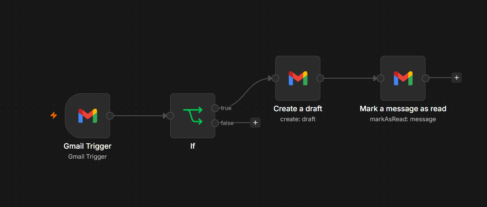
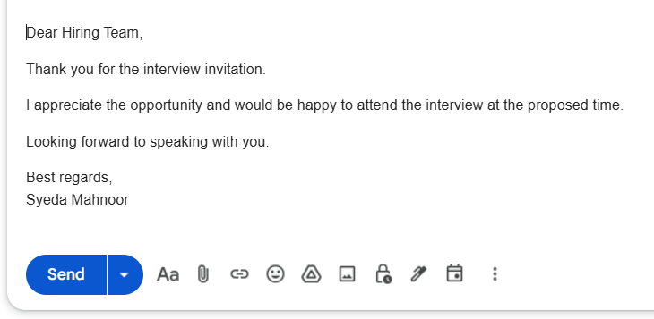

# Interview Invitation Draft Agent

A simple email automation workflow built using **n8n** that detects interview invitations, automatically creates a professionally formatted response draft, and prevents repeated processing of the same email.

## Workflow

**Gmail Trigger → IF → Create a Draft → Mark as Read**

## How It Works

1. **Gmail Trigger** detects incoming unread emails.
2. The **IF** node checks whether the email subject contains "Interview".
3. If the condition is true, Gmail automatically creates a professionally formatted HTML response draft.
4. After the draft is successfully created, the original email is marked as **Read** to prevent duplicate draft creation.
5. If the condition is false, no draft is created.

## IF Condition

Subject contains:

`Interview`

## Key Features

- Automatic detection of interview-related emails.
- Subject-based filtering using the IF node.
- Automatic creation of a professional email response draft.
- HTML formatting for readable paragraphs and spacing.
- Duplicate processing prevention by marking processed emails as read.
- Drafts are saved for manual review rather than sent automatically.

## Tools Used

- n8n
- Gmail
- Gmail Trigger
- IF Node
- Gmail Create Draft
- Gmail Mark as Read

## Workflow Screenshot

## Generated Draft

## Testing

The workflow was tested to verify that:

- Interview-related emails trigger draft creation.
- The original email is marked as read after successful draft creation.
- Already processed emails are not processed again.
- Generated drafts have proper HTML formatting.

## Future Improvements

- Customizable draft templates.
- More advanced email classification.
- Gmail labels for tracking processed messages independently of read/unread status.